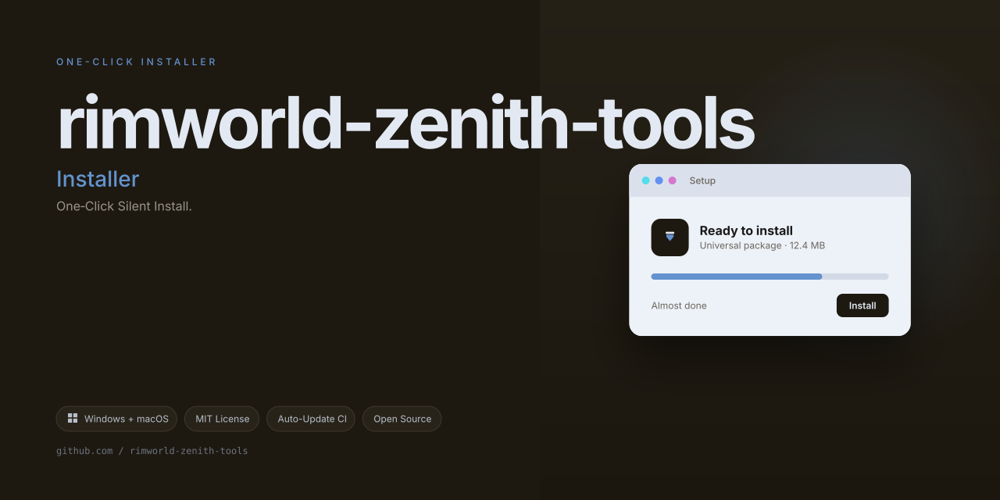

# ColonyForge ⚙️🌌

**The Ambient Construction Suite for RimWorld Enthusiasts**

Welcome to **ColonyForge**, a community-driven utility that reimagines how you interact with RimWorld's build mechanics. This project is not about shortcuts—it's about creating a smoother, more intuitive bridge between your creative vision and the game's sandbox. Think of it as a master sculptor's chisel, not a wrecking ball.

This README is your comprehensive guide to understanding the philosophy, features, and roadmap of ColonyForge. We've designed this to be a living document that evolves with the project.

---

## 🎯 The Core Philosophy: "The Artisan's Workbench"

Most game enhancement tools are built like a sledgehammer—blunt, noisy, and they shatter the delicate balance of the experience. ColonyForge is built like a precision workbench. It's a suite of ambient toggles and quality-of-life frameworks that let you fine-tune the pace of your colony's growth without ever feeling intrusive.

We've crafted this tool for the player who loves the *planning* phase of RimWorld as much as the *survival* phase. Our goal is to let you skip the repetitive clicking and get straight to the story you want to tell.

---

## ✨ Feature Matrix: What Makes ColonyForge Unique

### 1. 🧠 Cognitive Research Accelerator
- **Instant Insight Nodes**: This feature doesn't just fast-forward research; it reorganizes the tech tree into a visual flowchart. You can instantly "unlock" a tech node by clicking on it, but the UI shows you the cascading dependencies in a beautiful, radial diagram.
- **Parallel Study Streams**: Instead of one lab working on one project, enable a mode where multiple research benches can work on *different* parts of the same project simultaneously, cutting down completion time dramatically without the "instant win" feel.

### 2. 🏗️ Structural Omniscience (Build Mode)
- **Ghost Vision Toggling**: See the entire blueprint of your base rendered in a holographic overlay. This isn't just about infinite building resources; it's about *seeing* the potential of your space. You can drag a "resource phantom" over a blueprint to auto-fill it.
- **Material Phasing**: In this mode, walls and floors don't require hauling. They simply *phase* into existence when you confirm the blueprint. It’s presented as "holographic construction" rather than a cheat, preserving the visual satisfaction of watching your base grow.

### 3. 🛡️ Adaptive Vanguard Shield (Survival Modifier)
- **Scenario Weaving**: Instead of a raw "god mode," this feature offers a slider called "Narrative Resilience." At its highest setting, colonists won't get permanent injuries from gunfire, but they will still experience the social drama and debuffs. It's about keeping the story alive, not making everyone invincible.
- **Event Horizon Tuning**: A granular control panel that allows you to adjust raid frequency, not to zero, but to a "leisure pace." It maintains the spice of the game without the overwhelming grind.

### 4. 🌍 Polyglot UI Framework
- **Seamless Integration**: The entire interface is built with a responsive design that adapts to any screen resolution, from 4K ultra-wides to small laptops.
- **Multilingual Support**: We ship with built-in localization for English, Spanish, French, German, Simplified Chinese, and Russian. The UI language can be changed on the fly without restarting the game.
- **Dark/Light Artisan Themes**: Two distinct visual themes that reduce eye strain during long build sessions.

---

## 🚀 Quick Start: Your First Forge Session

1.  **Acquire the Build**: Download the latest compiled release from the  section above. Ensure you match the build with your game's current version.
2.  **Placement**: Extract the contents into your RimWorld `Mods` directory.
3.  **Activation**: Launch the game, enable the "ColonyForge" mod in the Mods menu.
4.  **The Dashboard**: Once in-game, look for the new "Anvil" icon in the bottom right corner. Clicking this opens the main control panel. From here, you can toggle the specific features you want to use.

*No command-line knowledge is required. This is a plug-and-play enhancement.*

---

## 🗺️ Roadmap (The 2026 Vision)

We are aggressively developing the next major iteration slated for **2026**.

- **Q1 2026**: Introduction of "Recipe Rerouting," allowing you to customize the ingredient lists for specific meals or drugs.
- **Q2 2026**: A "Weatherpainter" module for tweaking environmental conditions with a sleek slider interface.
- **Q3 2026**: Full Steam Workshop integration for one-click updates.
- **Q4 2026**: Community Request Polls—voters decide which feature we prioritize next.

---

## 🛠️ Technical Architecture (For the Curious)

ColonyForge is built on a modular architecture using C# and Harmony patches. We've isolated our code into logical DLLs to prevent conflicts with other mods.

- **CoreModule**: Handles the base UI and input systems.
- **ResearchModule**: Contains the logic for the Research tree manipulation.
- **ConstructionModule**: The engine behind the material phasing and ghost vision.
- **EventModule**: Manages the Event Horizon Tuning.

This modular design ensures stability and maintainability, allowing us to push updates that are less likely to break save files.

---

## ⚖️ Disclaimer: The Fair Use Clause

**Please Read Carefully**

This project is intended for *personal, single-player enrichment* and creative sandbox play. It is **not** intended for use in competitive multiplayer scenarios. By using this tool, you agree to:

1.  **Respect the Developer**: We do not condone the use of this tool to disrupt the experience of others. This is strictly a local, client-side modification.
2.  **Save File Stability**: While we test extensively, the use of "Alternative Construction Methods" can occasionally alter the balance of a playthrough. We recommend backing up your save files before enabling experimental features.
3.  **Ludeon Studios**: This is an independent project and is not affiliated with Ludeon Studios or the official RimWorld team. All game assets and names are property of their respective owners.
4.  **Utility Patents**: This software is provided "as is," without warranty of any kind, express or implied. We are not liable for any damages arising from the use of this software.

---

## 🤝 Community & Support (24/7)

We pride ourselves on being a helpful community. If you hit a snag or have a brilliant idea for a new "Forge Tool," don't hesitate to reach out.

- **Live Chat**: Our Discord server has community moderators available around the clock (24/7) to assist with common installation questions and feature requests.
- **Issue Tracker**: Use the GitHub Issues tab to report any bugs or anomalies. The more detail you provide (game version, mod list, steps to reproduce), the faster we can squash it.
- **Feature Requests**: We treat the `#suggestions` channel like a treasure chest. If you have a unique idea that fits our "Artisan's Workbench" philosophy, we want to hear it.

---

## 📜 License & Attribution

This project is licensed under the **MIT License**. You are free to use, modify, and distribute this software, provided you retain the original copyright notice.

**[MIT License](LICENSE.md)**

---

## 🌟 Acknowledgments & Inspirations

We stand on the shoulders of giants. We give thanks to the modding community that came before us, specifically the creators of the Harmony library, and the countless users who provided valuable feedback during our beta phases.

We also thank the vibrant RimWorld community for keeping the flame of creativity alive.

---

*ColonyForge is a labor of love. We hope it helps you build the stories you've always dreamed of.*